<div align="center">
  
</div>

<br/>

### ⚡ `$ cat ~/about_me.txt`

```yaml
author: "MonkeyTuan (@TuanAnhk10)"
role: "Independent Security Researcher"
focus_areas:
  - "Web & API Penetration Testing (OWASP API Security Top 10: 2023)"
  - "Multi-Tier Architecture Auditing (Next.js App Router RSC, Spring Boot, Cloud Storage)"
  - "Media Streaming & Cryptographic DRM Analysis (HLS AES-128-CBC, MPEG-TS, Shaka Packager)"
  - "Automated Exploit Tooling & Local Vulnerable Lab Simulation (Python, PyCryptodome, Pytest)"
```

---

### 🛡️ Featured Security Research

#### 🔴 [security-research-project — Multi-Tier EdTech LMS & HLS AES-128 DRM Security Research](https://github.com/TuanAnhk10/security-research-project)

[](https://github.com/TuanAnhk10/security-research-project/blob/main/docs/findings.md)
[](https://github.com/TuanAnhk10/security-research-project/blob/main/docs/threat-model.md)
[](https://github.com/TuanAnhk10/security-research-project/tree/main/lab)

> **End-to-End Grey/Black-Box Case Study**: Demonstrates how inconsistent authorization boundaries across microservices completely neutralize cryptographic video DRM protections:
> - **`FIND-01` (CVSS 9.8 — Critical)**: Differential authorization bypass between `/api/shaka/token` (`401`) and `/api/shaka/status/{id}` (`200 OK`) + unauthenticated upstream `/api/media`, exposing **312 proprietary video records** and their raw 16-byte `AES-128-CBC` keys & IVs.
> - **`FIND-02` (CVSS 9.1 — Critical)**: Direct public Cloudflare R2 bucket access (`/hls/**` & `/lectures/pdf/**`) bypassing the JWT-gated media CDN proxy.
> - **`FIND-03` to `FIND-06`**: Unauthenticated chunked video upload pipeline (`POST /api/upload/init`), Broken Object Level Authorization (BOLA) on active & archived PDF streams, predictable seeded migration UUIDs, and Next.js RSC Flight Stream (`RSC: 1`) over-posting of `DRAFT` records.
> - **Includes**: Full 6-Phase Methodology ([`docs/methodology.md`](https://github.com/TuanAnhk10/security-research-project/blob/main/docs/methodology.md)), STRIDE Threat Model ([`docs/threat-model.md`](https://github.com/TuanAnhk10/security-research-project/blob/main/docs/threat-model.md)), Defense-in-Depth Remediation Patches ([`docs/remediation.md`](https://github.com/TuanAnhk10/security-research-project/blob/main/docs/remediation.md)), and a self-contained Vulnerable Multi-Service Lab ([`lab/mock_edtech_stack.py`](https://github.com/TuanAnhk10/security-research-project/blob/main/lab/mock_edtech_stack.py)).

---

### 🛠️ Technical Arsenal

<p align="left">
  
  
  
  
  
  
  
</p>
